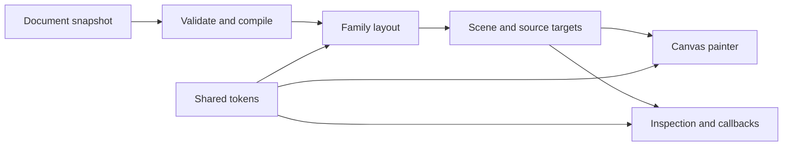

# Architecture

ScopeView turns a supplied document into a scene, paints it with Canvas, and reports exact source readings. The package has no runtime npm dependencies. The default browser API is a small view; complete components and custom rendering are separate entry points.

## Data flow

Data and computation stay separate from browser lifecycle. The compiler owns a normalized snapshot, with source strings preserved for inspection. Layout uses approximate CSS-pixel coordinates. The host owns fetching, aggregation, titles, controls and application actions.

## Source ownership

| Directory               | Responsibility                                                                      |
| ----------------------- | ----------------------------------------------------------------------------------- |
| `src/data/`             | Fields, exact values, time, formatting and validation primitives                    |
| `src/families/`         | Metric, trace and profile validation, compilation and layout                        |
| `src/core/`             | Scenes, hit contracts, sessions, ranges, viewports and semantic links               |
| `src/theme/`            | Strict host theme configuration, token source, generated defaults and shared styles |
| `src/renderers/canvas/` | Paint composition, contrast, surfaces and caches                                    |
| `src/runtime/`          | Measurement, input, invalidation and resource lifecycle                             |
| `src/ui/`               | Shared DOM construction, exact reading presentation and floating placement          |
| `src/views/`            | Headless mounting, transient readings, updates and disposal                         |
| `src/elements/`         | Optional component shells, controls, host events and adapters                       |
| `node/`                 | Published HTML exporter using built public entries                                  |

Metric code separates parsing, field/spec resolution, semantic compilation, data preparation and individual layouts. Trace/profile share hierarchy validation and interval layout. All browser surfaces use the same family geometry and painter. A component shell does not own another rendering implementation.

## Public entry points

Top-level `src/*.ts` files define the package's public ESM entries. `package.json` owns the entry list; builds derive it from exports. Declaration names must match the source entry. Internal modules import their owner directly rather than using public barrels.

The root API, data, core, families and token catalog are DOM-free. `/chart/axis` retains only axis validation/preparation/layout. Other fixed metric entries retain their own layout. `/report` loads the selected family and metric layout; `/headless` composes synchronous factories. `/scalar` excludes Canvas, family compilation and pointer runtime.

Headless views and components depend on shared text-safe reading and placement helpers in `ui/`; views do not import component-owned modules in `elements/`. Headless entries exclude component classes, controls and full shell CSS. `/interactions` adds persistent selection and hierarchy input separately, sharing only primitive record validation from `data/`. `/element` exposes component classes; `/register` performs registration. The standalone script uses headless factories.

## Dependency boundaries

Keep data and compilation independent of browser globals. Views share Canvas and reading helpers; component shells compose those views. Node tooling uses the built public library and Node built-ins. Production code has no external runtime dependencies.

`pnpm test:bundle` bundles actual public imports to verify Node-safe model use, optional registration, unused-import removal, small scalar/fixed-chart consumers, and retained fonts. See [bundle checks](bundle-size.md) for the concrete limits. These tests check shipped capabilities rather than enforcing a file-by-file source dependency graph.

## State and lifecycle

Reading, persistent selection, keyboard focus, ranges and viewports have distinct owners. Updates reconcile compatible targets; removed sources cannot retain stale selection. Invalid headless updates preserve the previous figure. Asynchronous report updates validate before loading and prevent stale downloads from overwriting newer data.

The internal `RuntimeLifecycle` base owns Canvas measurement, layout invalidation, frame scheduling, resize/font/DPR listeners, error recovery and resource disposal. `ReadingRuntime` and `ChartRuntime` retain their own sessions, input handling and paint-state projection. The base does not import range, link or viewport controllers, so sharing lifecycle code does not pull optional interaction capabilities into headless views.

Family-owned inspection context projectors expose exact source values, field roles and ancestry to headless callbacks and component events. Shared context types and opaque document snapshot identity live in `core/`. Both surfaces capture snapshot metadata on delivery and copy source fields together on the first data-field read; retaining an unread context keeps its original snapshot. Context follows the compiled document used by the rendered scene, including while a replacement is awaiting paint. Component events report the final reading and selection after replacement, with new context for preserved pins and null context for cleared sources. Notification tracking retains the last delivered state while loading temporarily clears runtime sessions; all dismissal paths consult that state. Inspection and selection reports have independent identities, checked with their source snapshot after synchronous host/control callbacks to discard superseded notifications. Ordinary repainting does not report selection changes. Application actions and transport remain host-owned.

Views own their child DOM; components release runtime resources on disconnect. Shared tokens and the [accepted design baseline](design-baseline.md) govern paint and reading behavior.

See [custom rendering](../docs/canvas-infra.md) for low-level consumers and [development](../CONTRIBUTING.md) for tests, scripts and packaging.

## Local tooling ownership

Node tooling imports the built public compiler and sibling helpers; it never imports source, private chunks or development scripts. `node/compile.mjs` loads the public compiler without retaining optional diagnostics. `node/document.mjs` derives summaries and warnings from one authoritative compilation. `node/html.mjs` embeds installed assets and returns HTML plus internal metadata; `node/embed.mjs` preserves the string-returning public API and optionally delivers the same diagnostics as CLI render. Export captions use the public token styles; token-only consumers can omit component shell CSS. `node/diagnostics.mjs` owns shared warnings and loads on demand for Node export callbacks. `node/resources.mjs` reads installed schema/examples/version, and `node/errors.mjs` owns transport classification. `node/cli.mjs` is the only executable entry; `node/command.mjs` owns parsing/protocol routing from one command/option table. `node/io.mjs` bounds reads, checks aliases, awaits streams and publishes files atomically. Node helpers and resources stay outside browser barrels.

JSON Schema is an authoring resource; it never replaces semantic compilation. ScopeView owns supplied documents and generic export, while query execution, raw database conversion, evidence bundles and host presentation belong to adapters outside this repository.

The self-contained CLI reuses the exact accepted npm tarball. Development-only distribution scripts verify a pinned official Node archive, copy its executable/license alongside the package and add a relative launcher. They never add a renderer or compiler implementation. The application code and resources keep their installed layout. CI builds and tests each supported platform. The [release workflow](../RELEASE.md) publishes the accepted artifacts after verification on every supported platform.
