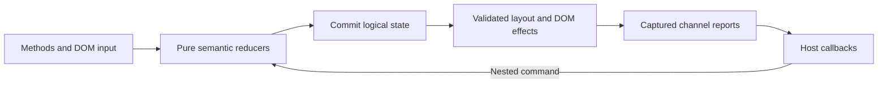

# Interaction transactions

Status: implemented. The transaction owner replaces separate inspection queues, pending pin/reveal fields and viewport revision queues. Public factory signatures, session/runtime methods, component events and inspection context types remain unchanged. This document records the internal ownership and the tested behavioral contract.

## Ownership

Each mounted chart has one DOM-free `Interaction` in `src/core/interaction.ts`. Its canonical reading record stores semantic keys, hover, selection, series, keyboard mode, model version and reading intent. `ReadingSession` implements pure synchronous reducers over that record; the public `ChartSession` adds the existing freeze/compare, lock, visibility and restoration policies. A component and its runtime share the record through session facades rather than copying selection between independent sessions.

`HierarchyInteraction` in `src/families/hierarchy/interaction.ts` owns the compiled hierarchy, expanded navigation, collapsed nodes, desired viewport, last positive measurement and complete focus intent. It uses the same session and transaction owner as its component. Family geometry stays in the existing layout and viewport primitives. Runtime adapters translate input and measurements; component shells own controls and DOM presentation.

Canvas providers are consumed once when a runtime is constructed. Releasing a borrowed runtime facade detaches it before resource disposal, so a retained old session cannot mutate the component's next lifecycle. An unrelated runtime subsequently created on the same Canvas receives its own owner.

## Commit and effect boundary

`Interaction.batch()` encloses a complete command. Reducers do not call application code, manipulate DOM or publish reports. Logical getters reflect the accepted state synchronously. Effects wait until the outer command finishes. A nested command issued by a callback commits immediately; its effects and reports run after the current callback or DOM broadcast completes. Older commands therefore have no semantic write left to resume after notification.

Effects carry a key and a currentness predicate. Admission rejects already stale work before it can replace a valid keyed effect. Execution revalidates the predicate. Operations that can call application code, including custom layout/renderer hooks and DOM focus/popover work, require revalidation before applying further results. Model versions protect against a custom layout adopting a newer semantic model without changing the runtime's own layout revision. Stale layout results and failures cannot replace that newer model.

The pump chooses the earliest nonempty phase after each effect, so nested presentation work finishes before subsequent reports. Existing entry-specific inspect/select ordering remains in the adapters.

| Phase | Responsibility                                      |
| ----- | --------------------------------------------------- |
| 0     | Resource cleanup, layout and reading presentation   |
| 1     | Component controls                                  |
| 2     | Inspect, select, collapse, visibility and errors    |
| 3     | Hierarchy viewport reports                          |
| 4     | Portable view-state reports                         |
| 5     | Ready reports for a still-current completed frame   |

A report marks its observable identity as published before invoking the host. Repeated same-value viewport or collapse acknowledgements terminate through value comparison, even if accepting them changes an internal intent. Toggle actions retain their existing semantics. Explicit inspection input can force a report where the existing API requires it; a quiet repaint cannot displace that pending report merely by capturing the same reading.

The pump runs at most 64 queued effects per synchronous flush. A host that keeps issuing different states yields to a timer task, allowing input, painting and other tasks to run. This bounds library draining; it does not attempt to terminate arbitrary host recursion inside a callback. A throwing observer does not roll back the committed state or abandon other valid work. Remaining work is scheduled before the first thrown value propagates, including when that value is `undefined`.

## Semantic targets and hidden geometry

`focusNode()` resolves identifiers against the compiled hierarchy and expands ancestors before adopting canonical navigation. It applies the existing pin policy and commits the full focus intent before painting, control events or viewport callbacks. A node absent from the old painted scene can therefore be accepted. Nested focus or keyboard commands replace the older reading intent before its remaining effects execute.

Zero dimensions are not a measurement. An initialized hidden chart retains its last positive height and unresolved positioning intent. A positive measurement derives reveal bounds from the current hierarchy and surviving focus intent. Newer viewport commands, dismissal, restoration, collapse or document replacement cancel obsolete positioning. The intent does not depend on finding the requested node in an old scene.

Loading retains its existing public policy: a component with an unavailable runtime preserves its saved portable state, and `focusNode()` does not invent a new active runtime. This differs from an initialized hidden chart, whose semantic model remains available. Before-first-paint, loading, disconnection and silent headless disposal keep their existing compatibility fixtures.

Canvas has one explicit Escape owner. It commits dismissal even for a noncancelable event, without suppressing other Canvas listeners that may restore newer state. The runtime skips dismissal when the Canvas owner is present. Shell fallback bubbles after toolbar widgets and skips the Canvas path, so it cannot clear a newer restore a second time.

## Snapshot and channel integrity

`captureScene()` stamps each completed scene with its compiled source snapshot. The `scene` getter continues to describe the last completed frame while a new document awaits paint. Pointer readings and exact context projection use the snapshot of that frame. A semantic target introduced by a new document waits for a compatible frame before a frame-dependent report; identical keys never cause old raw values to be reinterpreted against new data.

`InspectionNotifications` adapts inspect/select onto the shared pump. Identity includes snapshot, target key, series and observable pin state. Empty readings have one stable identity. Each channel has its own invalidation version, so unrelated hover changes cannot cancel a valid selection report. Captured payloads retain their original snapshot and exact values when listeners keep them after later updates.

Component viewport, controls and view-state adapters use the same publication protocol with their existing payloads. All listeners complete one DOM broadcast before the next report begins. A nested command can update getters immediately, while superseded pending intermediate reports are dropped. Ready delivery additionally validates connection, loading/error state and the completed source frame. A control callback that removes or replaces that frame cannot leave a successful ready event behind.

Document replacement commits the new source and clears controlled bindings before cleanup effects invoke host callbacks. A cleanup callback can submit another document; no older compile or render tail may overwrite it. Invalid headless updates continue to preserve the existing figure.

## Compatibility and package boundaries

The shared kernel, reading state and scene snapshot registry remain internal and DOM-free. Public `ChartSession` retains its constructor, getters, methods and pin/toggle behavior. Runtime and component API names and event details remain unchanged. Metric factory facades retain detached `update`, `refresh` and `dispose` calls and their own enumerable `theme` accessor; declaration compatibility alone would not cover those JavaScript behaviors.

Fixed metric entries share the plotted metric owner without retaining unreachable aggregate switching. The general metric entry alone switches between HTML aggregates and plots. Scalar remains HTML-only. Headless entries do not import component shells, registration stays explicit, and the standalone bundle consumes the built headless entry. Painter tokens, source colors, geometry and reading appearance are unchanged. Fixed bundled-consumer limits remain acceptance gates.

## Regression coverage

| Layer                                      | Coverage                                                                                                                       |
| ------------------------------------------ | ------------------------------------------------------------------------------------------------------------------------------ |
| `tests/unit/core/interaction.test.ts`      | Pump ordering, same-value feedback, stale admission, exceptions, session lifetime and 48 seeded trace/profile command runs     |
| Inspection coordinator and session units   | Independent channels, exact identity, explicit input, pin/lock/compare policy and restoration                                  |
| `interaction-transactions.spec.ts`         | Hidden/collapsed focus, two heights, pin modes, nested focus/keyboard, viewport order, feedback, Escape and ready cancellation |
| `inspection-transactions-matrix.spec.ts`   | Popover callback replacement across all 17 browser entries, committed cleanup state and detached metric facade methods         |
| `runtime-lifecycle.spec.ts`                | Stale custom layout results/errors, reused Canvas lifetime, keyboard reentry, hidden measurement and disposal                  |
| Existing browser family/entry matrices     | Exact readings, snapshots, source identity, API lifecycle, navigation and presentation compatibility                           |
| Type consumers and bundled/package tests   | Public declarations, DOM-free root, explicit registration, optional capabilities and installed consumers                       |

The seeded command tests use an independent last-intent reference projection across replacements, collapse, focus, viewport commands, zero/positive measurements, restoration, lifecycle and nested callback commands. Browser regressions exercise actual Canvas, popover, focus and event ordering. These checks establish concrete invariants and observed counterexamples; they are not a claim that future application code cannot introduce a new defect.
